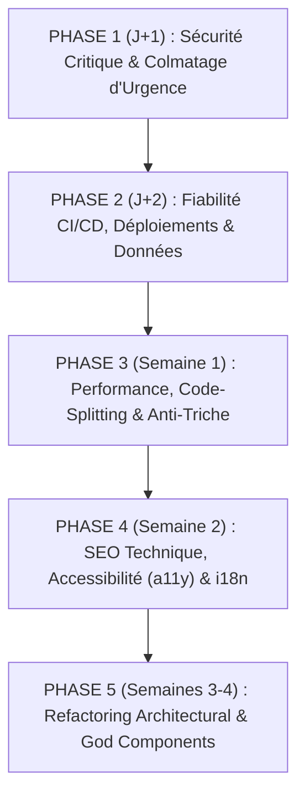

# AUDIT TECHNIQUE ULTRA-COMPLET & RAPPORT D'ARCHITECTE
**Projet** : Hoot Indie Games (`hoot-indie-games`)  
**Rôles** : Principal Software Architect, Staff Security Engineer & Performance Lead  
**Date d'audit** : 16 Octobre 2026  
**Cible d'inspection** : `/home/user/hoot-indie-games`  
**Statut** : Rapport d'Audit & Plan de Remédiation  

---

## SOMMAIRE GÉNÉRAL
1. [Architecture, Stack Technique & Score de Santé](#1-architecture-stack-technique--score-de-santé)
2. [Alertes Rouges (Sécurité & Bugs Critiques - À corriger immédiatement)](#2-alertes-rouges-sécurité--bugs-critiques---à-corriger-immédiatement)
3. [Problèmes Majeurs (Logique Métier, Jeux Quotidiens & Fiabilité)](#3-problèmes-majeurs-logique-métier-jeux-quotidiens--fiabilité)
4. [Performance, Concurrence, Base de Données & Front-end](#4-performance-concurrence-base-de-données--front-end)
5. [SEO Technique, Accessibilité (a11y) & Qualité du Code](#5-seo-technique-accessibilité-a11y--qualité-du-code)
6. [Quick Wins (Impact Fort / Effort Faible) & Plan d'Action Séquencé](#6-quick-wins-impact-fort--effort-faible--plan-daction-séquencé)

---

## 1. ARCHITECTURE, STACK TECHNIQUE & SCORE DE SANTÉ

### 1.1 Cartographie de la Stack Technique

| Domaine | Technologies Utilisées | Rôle & Analyse d'Intégration |
| :--- | :--- | :--- |
| **Front-end UI** | **React 19.2.8**, **TypeScript 6.0.2**, **Vite 8.3.0** | SPA CSR haute réactivité. Utilisation de `@vitejs/plugin-react` 6.1.1, architecture par composants modaux et vues dédiées. |
| **Styling & Design System** | **Tailwind CSS 4.3.3**, `@tailwindcss/vite` | Approche utility-first moderne (v4). Intégration de Lucide Icons (`lucide-react` 1.47.0) et Framer Motion (`framer-motion` 13.4.0). |
| **Composants d'Accessibilité** | `@headlessui/react` 2.2.10 | Prévu pour les modales et dialogues accessibles, mais exploité sur seulement 5 modales sur 24 (dette technique UI). |
| **Internationalisation** | `i18next` 26.4.2, `react-i18next` 17.0.14 | 6 langues cibles (`fr`, `en`, `es`, `de`, `ja`, `pt-BR`). Bundle de base `fr.json` compilé statiquement dans `i18n-core`, chargement dynamique pour les autres langues. |
| **Back-end & API Souveraine** | **PHP 8.x** natif (hébergement Apache mutualisé OVH) | 14 scripts API dans `public/api/*.php` gérant l'auth, la synchro cloud, les amis, les classements, la modération et le relais multijoueur. Stockage persistant via fichiers JSON plats et logs dans le webroot (`public/api/user_saves/`). |
| **Base de Données & Temps Réel** | **Supabase** (`@supabase/supabase-js` 2.116.0, PostgreSQL) | 5 fichiers de migration SQL sous `supabase/migrations/` pour le tchat temps réel, la modération, la messagerie privée, les duels Versus et le troc de cartes. |
| **Intégrations Externes Tierces** | Steam Web API (Valve), Steam OpenID 2.0, Resend API / Brevo API (e-mails), MyMemory API (traduction) | Authentification des profils Steam, import de ludothèques, envoi de codes de vérification OTP, traduction à la volée du tchat. |
| **Build & Outillage** | **tsx 4.23.13**, **sharp 0.35.5**, **oxlint 1.81.0** | Pipeline de pré-build générant le shell SEO statique (`scripts/generateSeoIndex.ts`) et optimisant les bannières WebP. Linting ultra-rapide par Oxlint. |
| **Déploiement & CI/CD** | **GitHub Actions**, FTP/FTPS OVH (`SamKirkland/FTP-Deploy-Action@v4.3.5`), Vercel / Netlify | Deux workflows principaux : `deploy-ovh.yml` (déploiement sur push `main`) et `daily-indie-harvest.yml` (récolte et build nocturne automatisé à 04h00 UTC). |

---

### 1.2 Cartographie Détaillée de l'Arborescence Source

```
hoot-indie-games/
├── .github/workflows/           # CI/CD : Déploiement OVH & Récolte nocturne automatisée
│   ├── deploy-ovh.yml
│   └── daily-indie-harvest.yml
├── public/                      # Assets statiques distribués tels quels
│   ├── api/                     # Back-end PHP souverain (14 endpoints REST & RPC)
│   │   ├── admin_auth.php       # Contrôle d'accès & validation CSRF super-administrateur
│   │   ├── user_auth.php        # Inscription, connexion, vérification email OTP, liaison Steam
│   │   ├── user_cloud_sync.php  # Validation Steam OpenID & passerelle de sauvegarde cloud
│   │   ├── leaderboard.php      # Soumission signée et consultation des classements mondiaux
│   │   ├── versus_room.php      # Relais de synchronisation des duels multijoueurs
│   │   ├── friends.php          # Système de code ami, requêtes sociales et consultation
│   │   ├── usernames.php        # Réservation et libération de pseudonymes souverains
│   │   ├── micro_indies.php     # Soumission communautaire et votes de jeux indés
│   │   ├── mailer.php           # Passerelle d'envoi d'e-mails de vérification (Resend/Brevo)
│   │   ├── track.php            # Télémétrie, statistiques visiteurs et actions administrateur
│   │   └── user_saves/          # Sauvegardes JSON plates par joueur (.htaccess restrictif)
│   ├── data/
│   │   └── steam_catalog.json   # Base de données exhaustive du catalogue Steam (4,51 Mo, 1 727 jeux)
│   ├── audio/blindtest/         # Clips audio certifiés pour le Blind Test
│   ├── sitemap.xml              # Plan de site pour moteurs de recherche
│   ├── robots.txt               # Directives de crawl robots
│   └── manifest.webmanifest     # Déclaration PWA
├── scripts/                     # 38 scripts d'outillage, moissonnage et tests TypeScript
│   ├── generateSeoIndex.ts      # Générateur du pré-rendu SEO statique de index.html
│   ├── harvestDailyIndieGames.ts# Récolte automatique quotidienne de nouveaux jeux
│   └── test*.ts                 # Suites de vérification logique (Odyssey, Trocs, Pseudos...)
├── src/
│   ├── components/              # 89 composants React répartis en 28 sous-dossiers thématiques
│   │   ├── admin/               # Panneau d'administration, modération & gestion de catalogue
│   │   ├── arcade/              # 8 jeux d'arcade Canvas rétro (2048, Flappy, Brick, etc.)
│   │   ├── blindtest/           # Blind Test audio musical quotidien
│   │   ├── cards/               # Classeur de collection de cartes, ouverture de boosters & troc
│   │   ├── chat/                # Tchat public temps réel et messagerie privée
│   │   ├── chrono/              # Mini-jeu quotidien de frise chronologique
│   │   ├── indledle/            # Défi Wordle-like sur les métadonnées de jeux
│   │   ├── linkle/              # Défi d'associations et de groupes thématiques
│   │   ├── microindies/         # Hub de vote et de promotion des micro-créations
│   │   ├── odyssey/             # Jeu incrémental / RPG compagnons (Odyssey)
│   │   ├── pixel/               # Défi de reconnaissance de capture pixelisée
│   │   ├── profille/            # Défi d'identification par indices progressifs
│   │   ├── quiz/                # Quiz interactif sur la culture indé
│   │   ├── review/              # Défi de déduction par avis Steam réels
│   │   ├── screenle/            # Jeu phare quotidien : deviner le jeu via un zoom progressif
│   │   ├── timeattack/          # 8 épreuves Sprint contre-la-montre de 60 secondes
│   │   └── versus/              # Arène de duels 1v1 multijoueur en temps réel
│   ├── context/                 # 10 Providers d'état global (Auth, Stats, Cartes, Tchat, Amis...)
│   ├── data/                    # Bases statiques (298 pépites certifiées, quiz, cartes, lore)
│   ├── i18n/                    # Dictionnaires de localisation et chargeurs dynamiques
│   ├── services/                # Clients réseau (Supabase, Steam, Leaderboard, Sauvegardes...)
│   ├── types/                   # Définitions TypeScript strictes des entités
│   ├── utils/                   # Moteurs mathématiques, audio, formats, anti-triche et scheduler
│   ├── App.tsx                  # Composant racine, routage par onglets, modales et orchestration
│   └── main.tsx                 # Point d'entrée DOM React 19 et hydratation
├── supabase/migrations/         # 5 migrations PostgreSQL & schémas de sécurité RLS
└── index.html                   # Document HTML racine enrichi du pré-rendu SEO statique
```

---

### 1.3 Score de Santé Global : 42 / 100

| Pilier d'Évaluation | Note / 20 | Statut | Synthèse des Vulnérabilités & Faiblesses Majeures |
| :--- | :---: | :---: | :--- |
| **1. Sécurité & Authentification** | **05 / 20** | **CRITIQUE** | Faille d'escalade administrateur triviale (CVSS 10.0), désactivation complète des RLS Supabase (`USING (true)`), fuite d'OTP/tokens via le fallback e-mail dev, IDOR massif sur les profils et listes d'amis, sel HMAC en clair côté client. |
| **2. Performance & Ressources** | **09 / 20** | **INSUFFISANT** | Téléchargement forcé de 4,51 Mo avec `?v=${Date.now()}` saturant le quota de 5 Mo de `localStorage`, neutralisation de `React.lazy` sur 13 modales au boot, fuites de boucles `setInterval` à 60 Hz et canvas gradients non optimisés. |
| **3. Architecture & Code** | **08 / 20** | **DETTE LOURDE** | 18 composants de plus de 1 000 lignes (jusqu'à 3 794 lignes), 11 composants orphelins (2 028 lignes de code mort), duplication massive entre les 8 épreuves de Sprint, 244 occurrences de `any` et 152 avertissements linter non résolus. |
| **4. SEO, UX & Accessibilité** | **10 / 20** | **MOYEN** | Sitemap XML invalide (14 URLs sur 15 avec fragment `#` ignoré par Googlebot), catalogue pré-rendu relégué dans `<noscript>`, faux `AggregateRating` exposé aux pénalités Google, 19 modales dépourvues de focus trap. |
| **5. CI/CD & DevOps** | **10 / 20** | **MOYEN** | Le workflow nocturne de récolte déploie chaque nuit une production **sans clés Supabase** et **supprime `.mail_config.php`**, déploiements effectués via FTP non chiffré sans verrou de concurrence. |

---

## 2. ALERTES ROUGES (SÉCURITÉ & BUGS CRITIQUES - À CORRIGER IMMÉDIATEMENT)

### [SEC-01] Prise de Contrôle Totale Super-Administrateur via Injection de `steamId` non vérifié
- **Fichier(s)** : `public/api/user_auth.php` (Lignes 268, 344-346, 613, 638) et `public/api/admin_auth.php` (Lignes 14, 178-180)
- **Diagnostic** : 
  Dans `public/api/user_auth.php`, les endpoints publics `action=register` et `action=link_steam` acceptent le paramètre `$payload['steamId']` directement issu du corps JSON envoyé par le client, sans aucune vérification d'authenticité cryptographique auprès de Valve OpenID. Le serveur écrit aveuglément cette valeur dans la session PHP :
  ```php
  // public/api/user_auth.php L344-346
  if (!empty($incomingSteamId)) {
      $_SESSION['steam_id'] = $incomingSteamId;
  }
  ```
  Or, dans `public/api/admin_auth.php`, la fonction `isCreatorAdminAuthorized()` considère qu'un utilisateur est le créateur / super-administrateur légitime si :
  ```php
  // public/api/admin_auth.php L178-180
  if (!empty($_SESSION['steam_id']) && strval($_SESSION['steam_id']) === ADMIN_STEAM_ID) {
      return true;
  }
  ```
  Puisque la constante `ADMIN_STEAM_ID` est publique et codée en dur (`'76561198035270542'`), un attaquant non authentifié n'a qu'à envoyer une requête POST d'inscription sur `/api/user_auth.php?action=register` avec le payload JSON `{"username":"Attacker","email":"att@evil.com","password":"Password123!","steamId":"76561198035270542"}`. Sa session PHP reçoit immédiatement `$_SESSION['steam_id'] = '76561198035270542'`, ce qui lui octroie les pleins privilèges super-administrateur sur l'intégralité du site (`admin_games.php`, `track.php`, `micro_indies.php`, `usernames.php`). De surcroît, comme `$_SESSION['admin_auth']` n'est pas initialisé lors de cette élévation, les contrôles CSRF dans `admin_games.php` (L251) et `track.php` (L659) sont totalement court-circuités.
- **Correction recommandée** :
  1. Dans `public/api/admin_auth.php`, supprimer impérativement la vérification de complaisance sur `$_SESSION['steam_id']` et exiger `$_SESSION['admin_auth'] === true` ET `$_SESSION['admin_steam_id'] === ADMIN_STEAM_ID` avec régénération de session.
  2. Dans `public/api/user_auth.php`, ne jamais faire confiance à `$payload['steamId']` fourni par le client ; n'accepter que `$_SESSION['verified_steam_id']` validé via le flux Valve OpenID 2.0.
  ```php
  // public/api/admin_auth.php
  function isCreatorAdminAuthorized($explicitKey = null) {
      initSecureSession();
      if (!empty($_SESSION['admin_auth']) && $_SESSION['admin_auth'] === true 
          && strval($_SESSION['admin_steam_id'] ?? '') === ADMIN_STEAM_ID) {
          return true;
      }
      $adminPassFile = __DIR__ . '/.admin_pass';
      if (file_exists($adminPassFile)) {
          $realKey = trim(@file_get_contents($adminPassFile) ?: '');
          $headers = getallheaders();
          $providedKey = $explicitKey ?? ($headers['X-Admin-Key'] ?? ($_REQUEST['adminKey'] ?? ''));
          if (!empty($realKey) && !empty($providedKey) && hash_equals($realKey, trim(strval($providedKey)))) {
              return true;
          }
      }
      return false;
  }
  ```

---

### [SEC-02] Politiques Supabase RLS Complètement Désactivées (`USING (true) WITH CHECK (true)`) sur Toutes les Tables
- **Fichier(s)** : 
  - `supabase/migrations/20261007_02_fixes.sql` (Lignes 8-9)
  - `supabase/migrations/20261007_02_multiplayer_and_moderation_fix.sql` (Lignes 6-8, 14-15, 31, 48)
  - `supabase/migrations/20261007_03_versus_arena.sql` (Lignes 14, 25)
  - `supabase/migrations/20261013_01_chat_fixes.sql` (Lignes 22-25, 45-47)
- **Diagnostic** :
  Comme l'authentification applicative a été construite en PHP sur Apache sans faire correspondre les utilisateurs avec Supabase Auth (`auth.uid()` retourne systématiquement `null`), les migrations ont progressivement ouvert toutes les politiques RLS à la clé publique anonyme (`anonKey`, exposée dans le bundle client via `VITE_SUPABASE_ANON_KEY`) :
  ```sql
  -- supabase/migrations/20261007_02_multiplayer_and_moderation_fix.sql L31 & L48
  CREATE POLICY "Anyone can do anything on private messages" ON private_messages USING (true) WITH CHECK (true);
  CREATE POLICY "Anyone can do anything on moderation logs" ON chat_moderation_logs USING (true) WITH CHECK (true);

  -- supabase/migrations/20261013_01_chat_fixes.sql L24-25 & L47
  CREATE POLICY "Anyone can update chat" ON chat_messages FOR UPDATE USING (true) WITH CHECK (true);
  CREATE POLICY "Anyone can delete chat" ON chat_messages FOR DELETE USING (true);
  ALTER PUBLICATION supabase_realtime ADD TABLE private_messages;
  ```
  **Conséquences directes** :
  1. **Fuite totale de la correspondance privée** : Tout visiteur ou attaquant peut exécuter `supabase.from('private_messages').select('*')` pour lire toutes les conversations privées de tous les utilisateurs du site.
  2. **Écoute passive temps réel** : La directive `ALTER PUBLICATION supabase_realtime ADD TABLE private_messages` avec `REPLICA IDENTITY FULL` diffuse chaque message privé échangé via WebSocket à toute personne connectée au canal public Realtime.
  3. **Vandalisme et destruction des données** : N'importe quel client peut modifier ou supprimer l'ensemble des messages du tchat public (`DELETE FROM chat_messages`), manipuler les échanges de cartes (`card_trades`), altérer les salons de duel (`versus_rooms`) et détruire les journaux de modération (`chat_moderation_logs`).
- **Correction recommandée** :
  1. Révoquer immédiatement les politiques permissives ouvertes.
  2. Restreindre `private_messages` et `chat_moderation_logs` : l'insertion doit être conditionnée et la lecture/suppression réservée au rôle serveur `service_role` ou aux participants vérifiés.
  3. Supprimer les politiques `UPDATE` et `DELETE` publiques sur `chat_messages`.
  ```sql
  -- Correction des RLS sur Supabase
  DROP POLICY IF EXISTS "Anyone can do anything on private messages" ON private_messages;
  DROP POLICY IF EXISTS "Anyone can do anything on moderation logs" ON chat_moderation_logs;
  DROP POLICY IF EXISTS "Anyone can update chat" ON chat_messages;
  DROP POLICY IF EXISTS "Anyone can delete chat" ON chat_messages;

  -- Interdire l'écoute globale de private_messages dans Realtime
  ALTER PUBLICATION supabase_realtime DROP TABLE private_messages;
  ALTER TABLE private_messages REPLICA IDENTITY DEFAULT;

  -- Protection sur chat_messages
  CREATE POLICY "Public insert chat message" ON chat_messages
      FOR INSERT WITH CHECK (
          is_deleted = FALSE 
          AND char_length(content) BETWEEN 1 AND 1000
          AND char_length(coalesce(username, '')) <= 32
      );
  ```

---

### [SEC-03] Fuite d'OTP et Prise de Contrôle de Compte sans Mot de Passe via le Fallback `mailDev`
- **Fichier(s)** : `public/api/mailer.php` (Lignes 19-28, 187-295) et `public/api/user_auth.php` (Lignes 356-361, 465-474, 506-511, 599-604)
- **Diagnostic** :
  1. Dans `public/api/mailer.php` (L187-266), lorsque l'API Resend ou Brevo échoue (clé manquante, erreur réseau, quota dépassé HTTP 429), la fonction continue son exécution jusqu'au bloc de fallback local :
  ```php
  // public/api/mailer.php L288-294
  return [
      'success' => true,
      'provider' => 'dev',
      'message' => 'E-mail enregistré dans le journal de développement local (.mail_dev.log).',
      'devLogged' => true,
      'token' => $token,
      'otp' => $otp,
      'verifyUrl' => $verifyUrl,
  ];
  ```
  2. Dans `public/api/user_auth.php` (L356-361 et L599-604), le serveur renvoie l'objet `mailDev` contenant le code OTP et le token en clair dans la réponse HTTP publique :
  ```php
  if (!empty($mailResult['devLogged'])) {
      $resp['mailDev'] = [
          'devLogged' => true,
          'otp' => $mailResult['otp'] ?? null,
          'token' => $mailResult['token'] ?? null,
          'verifyUrl' => $mailResult['verifyUrl'] ?? null,
      ];
  }
  ```
  3. Dans `verify_email` (`public/api/user_auth.php` L465-511), le serveur recherche l'OTP parmi **tous les utilisateurs enregistrés** et, s'il trouve une correspondance, **connecte immédiatement l'appelant en ouvrant sa session** :
  ```php
  if (empty($_SESSION['hoot_user_id'])) {
      session_regenerate_id(true);
      $_SESSION['hoot_user_id'] = $matchedUserId;
      $_SESSION['hoot_user_email'] = $accounts['users'][$matchedUserId]['email'] ?? '';
  }
  ```
  Un attaquant ciblant le compte d'un joueur appelle `resend_verification` pour son email, reçoit le code OTP dans la réponse HTTP en cas de panne ou mauvaise configuration du mailer, valide ce code via `verify_email` et se retrouve connecté sur le compte sans connaître le mot de passe.
- **Correction recommandée** :
  Ne jamais exposer `otp`, `token` ou `verifyUrl` dans les réponses JSON lorsque l'environnement n'est pas explicitement local (`APP_ENV !== 'local'`). Exiger une session active avant de valider un code OTP court à 6 chiffres.

---

### [SEC-04] Détournement et Écrasement Universel des Sauvegardes Cloud (`user_cloud_saves`) sans Auth (IDOR)
- **Fichier(s)** : `src/services/userCloudSyncService.ts` (Lignes 709-720, 755-778) et `public/api/user_auth.php` (Ligne 291)
- **Diagnostic** :
  1. `public/api/user_auth.php` génère des identifiants utilisateur au format `user_` suivi de 16 caractères hexadécimaux (`user_a1b2c3d4e5f60718`).
  2. Dans `src/services/userCloudSyncService.ts`, la fonction `isValidUUID(identifiers.userId)` (L711) renvoie systématiquement `false` pour ces identifiants souverains. Le service bascule alors sur une requête Supabase par `username` ou `steam_id` :
  ```ts
  // src/services/userCloudSyncService.ts L715-718 & L759-762
  if (identifiers.steamId) {
    query = query.eq('steam_id', identifiers.steamId);
  } else if (cleanUser) {
    query = query.eq('username', cleanUser);
  }
  ```
  3. L'écriture `pushUserCloudSave` fait un `SELECT id FROM user_cloud_saves WHERE username = cleanUser` puis un `UPDATE user_cloud_saves SET payload = ... WHERE id = targetId`.
  Comme Supabase autorise les écritures anonymes sans vérifier de jeton de session JWT lié au compte, n'importe quel utilisateur peut injecter le `username` ou le `steamId` d'un tiers dans son profil local et écraser définitivement la sauvegarde Cloud de sa victime.
- **Correction recommandée** :
  Faire transiter les lectures et écritures de sauvegardes Cloud exclusivement par l'API backend souveraine (`/api/user_cloud_sync.php`) authentifiée par cookie de session `HttpOnly`, ou signer des tokens JWT Supabase vérifiant `auth.uid()`.

---

### [SEC-05] Écrasement Global Destructeur de TOUS les Records du Site par l'Administrateur & Vol d'Identifiant de Score
- **Fichier(s)** : `public/api/leaderboard.php` (Lignes 260-274, 415-455)
- **Diagnostic** :
  1. **Destruction intégrale du Leaderboard par l'Admin (L265)** :
  Dans l'action `update_player_profile`, la mise à jour des entrées du fichier `leaderboard_data.json` est régie par la condition suivante :
  ```php
  // public/api/leaderboard.php L265-272
  if ($matchAcc || isCreatorAdminAuthorized()) {
      $entry['nickname'] = $cleanNick;
      $entry['avatar'] = $newAvatar;
      if (!empty($accountId)) {
          $entry['accountId'] = $accountId;
      }
      $updatedCount++;
  }
  ```
  Cette boucle itère sur l'intégralité des jeux et des scores enregistrés. Dès lors que le super-administrateur met à jour son propre pseudonyme ou son avatar, `isCreatorAdminAuthorized()` est `true` pour **100 % des entrées de tous les joueurs**. Cette action remplace instantanément le pseudo, l'avatar et l'`accountId` de tous les records du site par ceux de l'administrateur, détruisant l'intégralité du classement mondial.
  2. **Vol de compte Leaderboard (`accountId`) par collision de pseudo (L420-454)** :
  Lors de la soumission d'un score, si le pseudonyme soumis correspond à un pseudo déjà classé, mais avec un score inférieur au record existant, le serveur exécute :
  ```php
  // public/api/leaderboard.php L448-453
  $data[$category][$game][$existingIndex]['avatar'] = $avatar;
  if (!empty($accountId)) {
      $data[$category][$game][$existingIndex]['accountId'] = $accountId;
  }
  ```
  Un attaquant soumettant un score de `1` avec le pseudonyme du joueur numéro 1 et son propre `accountId` vole l'association d'identifiant de la victime, ce qui lui permet ensuite d'appeler `update_player_profile` pour renommer tous les records du joueur légitime.
- **Correction recommandée** :
  1. Supprimer immédiatement `|| isCreatorAdminAuthorized()` de la boucle de modification globale dans `update_player_profile`.
  2. Interdire à une requête d'associer un nouvel `accountId` sur une entrée existante sans preuve d'authentification.
  ```php
  // public/api/leaderboard.php L260-270 corrigé
  foreach ($entries as &$entry) {
      $eAcc = trim($entry['accountId'] ?? '');
      // Seul l'identifiant exact du compte détenteur permet la mise à jour
      if (!empty($accountId) && !empty($eAcc) && hash_equals($eAcc, $accountId)) {
          $entry['nickname'] = $cleanNick;
          $entry['avatar'] = $newAvatar;
          $updatedCount++;
      }
  }
  ```

---

### [SEC-06] Usurpation d'Identité, Écrasement de Profil Joueur et IDOR Massif sur le Réseau d'Amis
- **Fichier(s)** : `public/api/friends.php` (Lignes 249-388, 572-704, 864-899)
- **Diagnostic** :
  `public/api/friends.php` ne vérifie aucune session PHP (`$_SESSION`) pour ses actions de mutation.
  1. Dans `action=register` (L327-341), le script compare le `steamId` ou le `username` envoyé dans le corps JSON avec les données existantes de `$db['players'][$friendCode]`. Comme ces données sont publiques et consultables par tous via `action=lookup` ou `action=get_friends`, n'importe qui peut forger une requête d'inscription pour écraser le profil, l'Elo, les streaks et l'avatar de n'importe quel joueur.
  2. Dans `action=send_request`, `action=get_requests`, `action=respond_request` et `action=remove_friend`, le serveur se base uniquement sur les chaînes `fromCode` et `myCode` transmises par le client. N'importe quel tiers peut lire les demandes d'amis d'un autre joueur, accepter des demandes à sa place ou purger sa liste d'amis.
- **Correction recommandée** :
  Authentifier chaque requête par la session PHP active (`$_SESSION['hoot_user_id']` ou `$_SESSION['verified_steam_id']`), ou exiger un `friendSecretToken` (généré aléatoirement lors de la création du code ami et stocké sous forme de hash SHA-256) transmis dans l'en-tête `Authorization` / `X-Friend-Token`.

---

### [SEC-07] Vol et Libération Forcée de Pseudonyme sans Authentification
- **Fichier(s)** : `public/api/usernames.php` (Lignes 368-370, 489-496)
- **Diagnostic** :
  L'endpoint `action=claim` accepte les paramètres `$payload['userId']` et `$payload['steamId']` fournis par le client sans vérifier s'ils correspondent à l'utilisateur actuellement connecté en session.
  ```php
  // public/api/usernames.php L489-496
  $identKey = !empty($steamId) ? "steam_{$steamId}" : "user_{$userId}";
  $oldNorm = $db['userToName'][$identKey] ?? null;
  if ($oldNorm && $oldNorm !== $normalized && isset($db['usernames'][$oldNorm])) {
      if (empty($db['usernames'][$oldNorm]['isAdminReserved'])) {
          unset($db['usernames'][$oldNorm]);
      }
  }
  ```
  Un attaquant connaissant le Steam ID (public) ou le `userId` d'un joueur peut soumettre un pseudonyme jeton au nom de la victime. La commande `unset($db['usernames'][$oldNorm])` supprime immédiatement la réservation du vrai pseudonyme de la victime, permettant à l'attaquant de se l'approprier sur son propre compte.
- **Correction recommandée** :
  Vérifier rigoureusement que `steamId` et `userId` correspondent à `$_SESSION['verified_steam_id']` et `$_SESSION['hoot_user_id']`.

---

### [SEC-08] Déploiement Nocturne Automatisé Cassant Supabase en Production et Supprimant `.mail_config.php`
- **Fichier(s)** : `.github/workflows/daily-indie-harvest.yml` (Lignes 42-44, 55, 69-78) et `.github/workflows/deploy-ovh.yml` (Lignes 33-46)
- **Diagnostic** :
  1. Le workflow nocturne `daily-indie-harvest.yml` s'exécute chaque nuit à 04h00 UTC pour récolter de nouveaux jeux et reconstruire le site.
  2. À la ligne 43, il exécute `npm run build` **sans injecter les variables d'environnement `VITE_SUPABASE_URL` et `VITE_SUPABASE_ANON_KEY`** (alors que `deploy-ovh.yml` les injecte aux lignes 33-36). Par conséquent, le bundle Vite compilé la nuit contient des chaînes vides pour Supabase (`isSupabaseConfigured = false`).
  3. À la ligne 55, le workflow commite avec le flag `[skip ci]`, empêchant `deploy-ovh.yml` de se déclencher par la suite.
  4. Aux lignes 69-78, `daily-indie-harvest.yml` déploie directement le dossier `./dist/` sur le serveur OVH via FTP. Comme ce workflow ne génère pas `dist/api/.mail_config.php` avant le déploiement, `SamKirkland/FTP-Deploy-Action@v4.3.5` **supprime `/www/api/.mail_config.php` du serveur de production** pour aligner l'état distant avec le dossier local.
  **Impact** : Chaque nuit, la production perd sa connexion à Supabase (coupant l'auth, la synchro cloud, le tchat et les classements) et son fichier de configuration d'e-mails Resend.
- **Correction recommandée** :
  Harmoniser les deux workflows : injecter `VITE_SUPABASE_URL`, `VITE_SUPABASE_ANON_KEY` et générer `dist/api/.mail_config.php` dans `daily-indie-harvest.yml`, ou fusionner le build et le déploiement dans une action composite réutilisable.

---

### [SEC-09] Configuration CORS Invalide (`*` + `Credentials: true`), Fuite de `.admin_pass` et Encodage Invalide dans `user_cloud_sync.php`
- **Fichier(s)** : `public/api/user_cloud_sync.php` (Lignes 4-7, 60, 75, 82-85, 90)
- **Diagnostic** :
  1. **Violation de la spécification W3C CORS (L4-7)** : Le script envoie simultanément `Access-Control-Allow-Origin: *` et `Access-Control-Allow-Credentials: true`. Les navigateurs modernes rejettent purement et simplement toute réponse authentifiée comportant ces deux en-têtes contradictoires.
  2. **Fuite du secret maître serveur `.admin_pass` (L82-85)** :
  ```php
  $adminPassFile = __DIR__ . "/.admin_pass";
  if (file_exists($adminPassFile)) {
      $resData["adminKey"] = trim(@file_get_contents($adminPassFile) ?: "");
  }
  ```
  Le jeton maître du serveur est renvoyé en clair dans le payload HTTP JSON lors de la validation OpenID.
  3. **Caractères corrompus invalidant `json_encode` (L60, L75, L90)** : Le fichier contient des caractères ISO-8859-1 (`0xE9` dans `rejetée`, `validée`, `trouvé`) sans indicateur UTF-8, causant l'échec silencieux de `json_encode($resData)` (qui retourne `false` et produit une réponse HTTP totalement vide `""`).
- **Correction recommandée** :
  Remplacer les en-têtes CORS sauvages par la fonction `sendCorsHeaders()` de `admin_auth.php`, ne jamais renvoyer `.admin_pass` au client, et encoder le fichier en UTF-8 strict.

---

### [SEC-10] Action `give_reward` Totalement Inopérante (Erreur Fatale PHP 500, Variable Indéfinie & Stockage Mort)
- **Fichier(s)** : `public/api/track.php` (Lignes 895-907, 938-1039) et `src/services/userCloudSyncService.ts` (Lignes 930-932)
- **Diagnostic** :
  1. `public/api/track.php` L896 vérifie `if (!$isCreatorAdmin)`, or la variable `$isCreatorAdmin` **n'est jamais déclarée ni initialisée** dans ce script (elle s'appelle `$isAuth` à la ligne 528). La condition échoue et retourne systématiquement une erreur HTTP 403.
  2. Aux lignes 904 et 906, le script appelle `sanitizeStr()`, fonction qui n'existe pas dans `track.php` (elle n'est définie que dans `admin_games.php`), ce qui provoque une **Erreur Fatale PHP 500** si la vérification d'autorisation est contournée.
  3. Le script persiste les récompenses dans `public/api/user_saves/*.json`, alors que l'application React lit désormais les profils et récompenses dans Supabase (`user_profiles`), et que `acknowledgeAdminReward()` dans `src/services/userCloudSyncService.ts` (L930-932) est un stub vide retournant `return true;`.
- **Correction recommandée** :
  Définir `$isCreatorAdmin = isCreatorAdminAuthorized();`, déclarer la fonction `sanitizeStr()` ou importer un helper commun, et synchroniser l'attribution des récompenses directement avec la table Supabase `user_profiles`.

---

## 3. PROBLÈMES MAJEURS (LOGIQUE MÉTIER, JEUX QUOTIDIENS & FIABILITÉ)

### [BIZ-01] Fuite Directe des Réponses d'Énigmes dans le DOM & F12 via les URLs de Captures Steam et Styles CSS
- **Fichier(s)** : 
  - `src/components/screenle/ScreenleGame.tsx` (Lignes 381-402)
  - `src/components/timeattack/ScreenleSprint.tsx` (Lignes 388-415)
  - `src/components/versus/VersusArena.tsx` (Lignes 436-473, 1515-1520)
- **Diagnostic** :
  1. Dans `ScreenleGame.tsx` (L384), la capture d'écran affichée au joueur utilise une balise `` standard dont l'attribut `src={currentScreenshotUrl}` contient l'URL brute du CDN Steam :  
     `https://shared.akamai.steamstatic.com/store_item_assets/steam/apps/367520/ss_...jpg`.  
     Le nombre `367520` est l'**AppID Steam exact du jeu secret**. N'importe quel joueur ouvrant les DevTools (F12) ou faisant clic droit "Ouvrir l'image dans un nouvel onglet" identifie le jeu à la milliseconde sans le moindre effort.
  2. Le zoom progressif est appliqué purement en CSS via `transform: scale(${currentScale})`. Il suffit de décocher cette propriété dans l'inspecteur d'éléments pour afficher la capture complète non zoomée dès l'essai 1.
  3. Dans `VersusArena.tsx` (L436-473 & L1515-1520), en duel 1v1 classé (`screenle` et `pixel`), la même fuite se produit : l'image originale non masquée est injectée dans le DOM et simplement recouverte d'un filtre CSS `filter: blur(16px)`, désactivable en un clic dans l'inspecteur.
- **Correction recommandée** :
  Remplacer la balise `` par un composant `<canvas>` exploitant le helper existant `drawProtectedImageToCanvas()` (`src/utils/securityAntiCheat.ts` L308-363). Ce helper découpe et floute l'image dans un buffer mémoire 2D hors DOM sans jamais exposer l'image originale ni l'AppID Steam dans les attributs HTML.
  ```tsx
  // Correction dans ScreenleGame.tsx : Remplacement de  par un Canvas protégé
  const canvasRef = useRef<HTMLCanvasElement | null>(null);

  useEffect(() => {
    if (!canvasRef.current || !currentScreenshotUrl) return;
    drawProtectedImageToCanvas(canvasRef.current, currentScreenshotUrl, {
      scale: isCompleted ? 1 : currentScale,
      originX: originXPercent,
      originY: originYPercent,
      blurPx: isCompleted ? 0 : currentBlur,
    });
  }, [currentScreenshotUrl, currentScale, currentBlur, isCompleted]);

  return (
    <canvas 
      ref={canvasRef} 
      width={640} 
      height={360} 
      className="w-full h-full object-cover select-none pointer-events-none rounded-xl" 
    />
  );
  ```

---

### [BIZ-02] Fuite de `secretGameId` en Clair dans `localStorage` dès le 1er Essai
- **Fichier(s)** : 
  - `src/components/screenle/ScreenleGame.tsx` (Lignes 114-123, 238)
  - `src/components/indledle/IndledleGame.tsx` (Lignes 125-134, 247)
  - `src/components/profille/ProfilleGame.tsx` (Lignes 319-339, 524)
  - `src/components/chrono/ChronoGame.tsx` (Lignes 128-137)
- **Diagnostic** :
  Alors que `PixelGame.tsx` (L164), `ReviewGame.tsx` (L79) et `BlindTestGame.tsx` (L215) utilisent `saveSecureJson` pour obfusquer leur état, 4 mini-jeux quotidiens sauvegardent directement l'objet JSON en clair via `localStorage.setItem()` :
  ```tsx
  // src/components/screenle/ScreenleGame.tsx L116 & L238
  localStorage.setItem(`${STORAGE_PREFIX}${dateStr}`, JSON.stringify(state));
  // state contient explicitement : secretGameId: secretGame.id ("hollow-knight")
  ```
  Dès que le joueur soumet son premier essai (raté), `localStorage['screenle_state_2026-10-16']` contient `"secretGameId":"celeste"`. Il suffit d'ouvrir l'onglet Application > Local Storage dans F12 pour lire la solution de la partie en cours.
- **Correction recommandée** :
  1. Utiliser `saveSecureJson` / `loadSecureJson` (`src/utils/securityAntiCheat.ts`).
  2. Ne pas enregistrer `secretGameId` dans l'état de sauvegarde tant que la partie n'est pas terminée (`!isCompleted`), ou ne stocker qu'un hash SHA-256 salé de vérification.
  ```tsx
  // Dans ScreenleGame.tsx L235-245
  const stateToSave = {
    ...state,
    secretGameId: isCompleted ? secretGame.id : undefined,
    secretGameHash: !isCompleted ? sha256Sync(`${secretGame.id}:${dateStr}`) : undefined,
  };
  saveSecureJson(`${STORAGE_PREFIX}${dateStr}`, stateToSave);
  ```

---

### [BIZ-03] Désynchronisation Critique Minuit UTC vs Heure Locale (Bugs de Streaks et Calendrier)
- **Fichier(s)** : 
  - `src/utils/streakManager.ts` (Lignes 7-29)
  - `src/utils/monthlyScheduler.ts` (Lignes 183, 249-256)
  - `src/services/telemetry.ts` (Lignes 281-282)
  - `src/context/AchievementsProvider.tsx` (Lignes 41-43, 109-111)
- **Diagnostic** :
  1. `getTodayDateString()` (`src/utils/streakManager.ts` L7-12) calcule la date du jour en **UTC** :
  ```ts
  export const getTodayDateString = (date = new Date()): string => {
    const year = date.getUTCFullYear();
    const month = String(date.getUTCMonth() + 1).padStart(2, '0');
    const day = String(date.getUTCDate()).padStart(2, '0');
    return `${year}-${month}-${day}`;
  };
  ```
  Pour un joueur situé en France (UTC+1 en hiver, UTC+2 en été), le changement de jour officiel a lieu à **01h00 ou 02h00 du matin** au lieu de minuit ! Un joueur qui résout son défi quotidien à 00h30 joue en réalité sur la date UTC de la veille, créant des ruptures de séries (streaks) incompréhensibles et des collisions de calendrier.
  2. Dans `monthlyScheduler.ts` (L183), `new Date(year, month, 0).getDate()` calcule le nombre de jours en **heure locale**, tandis que `streakManager.ts` calcule les jours en **UTC**.
  3. Dans `telemetry.ts` (L281-282), le code enregistre `today` en UTC via `new Date().toISOString().split('T')[0]`, mais extrait juste en dessous l'heure en local via `String(new Date().getHours())`. Une session à 00h30 à Paris est ainsi enregistrée à l'heure locale `00` sur la date UTC de la veille !
- **Correction recommandée** :
  Définir un fuseau horaire pivot explicite pour toute l'application (soit `Europe/Paris` via `Intl.DateTimeFormat` pour la communauté francophone, soit l'heure locale du navigateur de façon 100 % cohérente entre tous les modules) :
  ```ts
  // src/utils/streakManager.ts unifié sur Europe/Paris
  export const getTodayDateString = (date = new Date()): string => {
    const formatter = new Intl.DateTimeFormat('en-CA', {
      timeZone: 'Europe/Paris',
      year: 'numeric',
      month: '2-digit',
      day: '2-digit',
    });
    return formatter.format(date); // Retourne toujours "YYYY-MM-DD" à minuit heure de Paris
  };
  ```

---

### [BIZ-04] Bug Majeur en Duel Versus (`VersusArena.tsx`) : En Mode `review` et `blindtest`, l'Indice ne Correspond PAS au Jeu à Deviner
- **Fichier(s)** : `src/components/versus/VersusArena.tsx` (Lignes 992-1008, 1172-1188)
- **Diagnostic** :
  Lors de la génération d'une nouvelle manche en duel multijoueur :
  ```tsx
  // src/components/versus/VersusArena.tsx L992-1008
  const game = pickRandomGame(gamePool);
  const choices = generateChoicesForGame(game, gamePool);

  let linkleData: DailyConnectionsPuzzle | null = null;
  let reviewData: DailyReviewPuzzle | null = null;
  let blindTestData: DailyBlindTestPuzzle | null = null;
  const seed = Date.now();
  if (disc === 'linkle') {
    linkleData = getRandomConnectionsPuzzle(seed);
  } else if (disc === 'review') {
    reviewData = getRandomReviewPuzzle(seed);
  } else if (disc === 'blindtest') {
    blindTestData = getRandomBlindTestPuzzle(seed);
  }

  setCurrentRoundGame(game);
  setCurrentRoundChoices(choices);
  ```
  `pickRandomGame(gamePool)` tire un premier jeu `A` (qui devient `currentRoundGame`, la bonne réponse vérifiée lors du clic à la ligne 1076 : `guessedGame.id === currentRoundGame.id`). Mais pour les disciplines `review` et `blindtest`, `getRandomReviewPuzzle(seed)` ou `getRandomBlindTestPuzzle(seed)` tire un **tout autre jeu `B`** de façon indépendante !  
  Le joueur voit donc la critique Steam ou entend l'OST du jeu `B` (ex: *Hollow Knight*). S'il clique sur *Hollow Knight*, sa réponse est marquée **fausse** car le système attendait le jeu `A` (*Celeste*).
- **Correction recommandée** :
  Extraire le jeu secret directement depuis le puzzle de critique ou de blind test généré :
  ```tsx
  // VersusArena.tsx L992-1008 corrigé
  const seed = Date.now();
  let game = pickRandomGame(gamePool);
  let reviewData: DailyReviewPuzzle | null = null;
  let blindTestData: DailyBlindTestPuzzle | null = null;

  if (disc === 'review') {
    reviewData = getRandomReviewPuzzle(seed);
    game = gamePool.find((g) => g.id === reviewData?.secretGame.id) || reviewData.secretGame;
  } else if (disc === 'blindtest') {
    blindTestData = getRandomBlindTestPuzzle(seed);
    game = gamePool.find((g) => g.id === blindTestData?.secretGame.id) || blindTestData.secretGame;
  }
  const choices = generateChoicesForGame(game, gamePool);
  setCurrentRoundGame(game);
  setCurrentRoundChoices(choices);
  ```

---

### [BIZ-05] Fuite de `gameId` en Clair dans le Payload Réseau P2P en Début de Manche Versus
- **Fichier(s)** : `src/components/versus/VersusArena.tsx` (Lignes 767-773, 1011-1018, 1191-1198)
- **Diagnostic** :
  Au lancement d'une manche de duel, l'hôte diffuse le message de démarrage à son adversaire via la table Supabase `versus_messages` ou le relais PHP `versus_room.php` :
  ```tsx
  // src/components/versus/VersusArena.tsx L1011-1018
  sendP2P({
    type: 'round_start',
    round: nextRound,
    gameId: game.id, // Ex: "celeste" en clair sur le réseau !
    choiceIds: choices.map((c) => c.id),
    discipline: disc,
    seed,
  });
  ```
  Tout joueur gardant l'onglet Network ouvert dans les outils de développement reçoit l'événement WebSocket/HTTP avec `gameId: "celeste"` à la première milliseconde du round, permettant une triche instantanée en duel compétitif.
- **Correction recommandée** :
  Ne pas transmettre `gameId` dans le message `round_start` : l'adversaire doit déterminer l'énigme à partir de la graine pseudo-aléatoire déterministe partagée `seed`, ou `gameId` doit être chiffré côté serveur.

---

### [BIZ-06] Absence d'AbortController, de Timeout et Blocs `catch {}` Vides sur les Appels Réseau Tiers
- **Fichier(s)** : 
  - `src/services/userAuthService.ts` (Lignes 46, 82, 110, 137, 159, 189, 230)
  - `src/services/steamService.ts` (Lignes 54, 188)
  - `src/utils/blindTestAudio.ts` (Lignes 19, 53)
  - `src/services/userCloudSyncService.ts` (19 occurrences de blocs `catch {}` vides)
- **Diagnostic** :
  1. À l'exception de `translationService.ts`, **aucun appel `fetch` de l'application n'utilise `AbortController` ni `AbortSignal.timeout()`**. En cas de connexion mobile ralentie ou de blocage réseau, les promesses restent en attente indéfinie, figeant les états d'interface (`isLoading`, `isSyncing`).
  2. Dans `blindTestAudio.ts` (L53), `getOrDecodeAudioBuffer(url)` lance `fetch(url)` sans propager le signal d'abandon. Si l'utilisateur quitte le Blind Test ou passe au morceau suivant, le téléchargement de plusieurs mégaoctets de fichier MP3 continue en tâche de fond, gaspillant la bande passante mobile.
  3. Dans `userCloudSyncService.ts`, 19 blocs `try { localStorage.setItem(...) } catch {}` étouffent silencieusement les erreurs `QuotaExceededError`. L'utilisateur croit sa progression enregistrée alors que le stockage local est plein.
- **Correction recommandée** :
  Créer un wrapper réseau `fetchWithTimeout(url, options, timeoutMs = 8000)` systématique et propager `signal` dans le lecteur audio du Blind Test. Intercepter `QuotaExceededError` dans un gestionnaire de stockage dédié.

---

### [BIZ-07] Exploitation Anti-Triche et Gel du Chronomètre dans les Sprints Contre-la-Montre
- **Fichier(s)** : 
  - `src/components/timeattack/BlindTestSprint.tsx` (Lignes 267-286)
  - `src/components/timeattack/ReviewSprint.tsx` (Lignes 131-150)
- **Diagnostic** :
  Dans ces deux épreuves de Sprint de 60 secondes :
  ```tsx
  // src/components/timeattack/BlindTestSprint.tsx L267-286
  useEffect(() => {
    if (status !== 'playing') return;

    const interval = setInterval(() => {
      setTimeLeft((prev) => {
        if (prev <= 1) {
          clearInterval(interval);
          handleGameOver();
          return 0;
        }
        return prev - 1;
      });
    }, 1000);

    return () => clearInterval(interval);
  }, [status, handleGameOver]);
  ```
  `handleGameOver` est un callback dépendant de `[score, correctCount, totalCount, maxCombo]`. Il est donc réinstancié à chaque réponse du joueur. Comme `handleGameOver` est présent dans les dépendances du `useEffect`, **l'intervalle de 1000ms est détruit et réinitialisé à zéro à chaque clic de réponse** ! Un joueur qui répond en moins d'une seconde réinitialise le timer avant chaque tick : le temps restant `timeLeft` ne diminue jamais et le joueur peut accumuler un score infini.
- **Correction recommandée** :
  Isoler le décompte du temps dans un `useEffect` ne dépendant que de `[status]`, et déclencher `handleGameOver` via un effet séparé observant `timeLeft <= 0`.
  ```tsx
  useEffect(() => {
    if (status !== 'playing') return;
    const timer = setInterval(() => {
      setTimeLeft((prev) => Math.max(0, prev - 1));
    }, 1000);
    return () => clearInterval(timer);
  }, [status]);

  useEffect(() => {
    if (status === 'playing' && timeLeft <= 0) {
      handleGameOver();
    }
  }, [status, timeLeft, handleGameOver]);
  ```

---

### [BIZ-08] Sel Cryptographique HMAC en Dur Côté Client & Faille ASCII dans `sha256Sync`
- **Fichier(s)** : `src/utils/securityAntiCheat.ts` (Lignes 21, 91, 140-148) et `src/services/leaderboardService.ts` (Lignes 274-285)
- **Diagnostic** :
  1. `export const LEADERBOARD_SECRET_SALT = 'hoot_sovereign_leaderboard_salt_2026';` est bundlé en clair dans le code JavaScript public. N'importe quel internaute peut appeler `generateScoreSignature()` dans la console F12 et certifier n'importe quel score arbitraire auprès de `/api/leaderboard.php`.
  2. **Bug de hachage ASCII (L91)** : L'implémentation maison `sha256Sync` comporte le garde-fou :
  ```ts
  // src/utils/securityAntiCheat.ts L90-92
  j = composite.charCodeAt(i);
  if (j >> 8) return ''; // ASCII only
  ```
  Dès qu'un titre de jeu ou un pseudo comporte un accent ou un caractère spécial (`é`, `à`, `è`, etc.), `sha256Sync` retourne une chaîne vide `""`, rendant la signature invalide et provoquant le rejet systématique des scores légitimes sur ces jeux par le serveur.
- **Correction recommandée** :
  Utiliser l'API standard `crypto.subtle.digest('SHA-256', new TextEncoder().encode(payload))` supportant l'UTF-8 complet, et faire valider la durée minimale théorique d'une partie par session serveur plutôt que de faire confiance à un sel exposé côté client.

---

## 4. PERFORMANCE, CONCURRENCE, BASE DE DONNÉES & FRONT-END

### [PERF-01] Cache-Busting Forcé (`?v=${Date.now()}`) et Dépassement Garanti du Quota `localStorage` avec `steam_catalog.json` (4,51 Mo)
- **Fichier(s)** : `src/services/steamCatalog.ts` (Lignes 255-276) et `public/data/steam_catalog.json` (4 505 937 octets, 87 866 lignes)
- **Diagnostic** :
  1. À la ligne 260 de `src/services/steamCatalog.ts`, le catalogue complet est chargé via :
  ```ts
  const res = await fetch(`/data/steam_catalog.json?v=${Date.now()}`, {
    cache: 'no-cache',
  });
  ```
  L'utilisation de `Date.now()` crée une URL unique à chaque rechargement et détruit 100 % de l'efficacité du cache HTTP du navigateur et du CDN d'OVH.
  2. À la ligne 273, le code tente de persister ce fichier de **4,51 Mo** dans `localStorage` :
  ```ts
  try {
    localStorage.setItem(STORAGE_KEY_STEAM_CATALOG, JSON.stringify(items));
    localStorage.setItem(STORAGE_KEY_STEAM_CATALOG_VERSION, CURRENT_CATALOG_VERSION);
  } catch {
    // Ignore storage quota errors
  }
  ```
  Sur Chrome, Firefox et Safari, le quota global de `localStorage` pour toute l'origine est de **5 Mo**. Le catalogue à lui seul sature 90 % de ce quota. L'appel échoue presque systématiquement avec `QuotaExceededError` (étouffé par le `catch {}`), ce qui force le navigateur à refaire le téléchargement de 4,51 Mo à chaque visite, ou sature l'espace au détriment des sauvegardes des parties, collections de cartes et profils utilisateur.
- **Correction recommandée** :
  1. Supprimer l'écriture de `steam_catalog.json` dans `localStorage` (utiliser `IndexedDB` si une persistance hors-ligne est requise).
  2. Remplacer `?v=${Date.now()}` par la version statique de l'application ou un hash de build (`?v=${CURRENT_CATALOG_VERSION}`), permettant au navigateur de mettre en cache les 4,51 Mo de manière pérenne.
  3. Minifier le fichier `public/data/steam_catalog.json` (qui est indenté avec 2 espaces dans les scripts de récolte, ce qui gaspille ~40 % de son poids).

---

### [PERF-02] Annulation de `React.lazy` dans `src/App.tsx` : 13 Modales + 8 Moteurs d'Arcade Téléchargés au Démarrage Initial
- **Fichier(s)** : `src/App.tsx` (Lignes 885-1002) et `src/components/arcade/ArcadeModal.tsx` (Lignes 31-38)
- **Diagnostic** :
  Dans `src/App.tsx`, 13 modales déclarées avec `React.lazy` sont rendues inconditionnellement dans le JSX avec la prop `isOpen={false}` :
  ```tsx
  // src/App.tsx L886-902
  <React.Suspense fallback={null}>
    <StatsModal isOpen={isStatsOpen} onClose={() => setIsStatsOpen(false)} />
    <AchievementsModal isOpen={isAchievementsOpen} onClose={() => setIsAchievementsOpen(false)} />
    <CalendarArchiveModal isOpen={isCalendarOpen} ... />
    <ProfileModal isOpen={isProfileOpen} ... />
    <FeatherShopModal isOpen={isShopOpen} ... />
    <FriendsModal isOpen={isFriendsOpen} ... />
    <AuthModal isOpen={isAuthModalOpen} ... />
    <EmailVerificationModal isOpen={isEmailVerifyModalOpen} ... />
    <OwlEasterEggModal isOpen={isEasterEggOpen} ... />
    <ArcadeModal isOpen={isArcadeOpen} ... />
    <LeaderboardModal isOpen={isLeaderboardOpen} ... />
  </React.Suspense>
  ```
  En React, instancier `<LazyComponent isOpen={false} />` force le runtime à **télécharger, évaluer et exécuter immédiatement le chunk JavaScript** pour qu'il puisse exécuter son propre `if (!isOpen) return null;`.  
  **Effet en cascade critique** : `ArcadeModal.tsx` importe statiquement les 8 jeux d'arcade Canvas aux lignes 31-38 (`ArcadeGame2048`, `ArcadeFlappyOwl`, `ArcadeBrickBreaker`, etc., soit **3 989 lignes de code Canvas**). Résultat : dès le premier chargement de la page d'accueil, le navigateur télécharge l'intégralité des 13 modales et des 8 jeux d'arcade, annulant complètement les bénéfices du code-splitting Vite.
- **Correction recommandée** :
  Conditionner le rendu à l'extérieur des composants lazy dans `src/App.tsx` :
  ```tsx
  <React.Suspense fallback={null}>
    {isStatsOpen && <StatsModal isOpen={isStatsOpen} onClose={() => setIsStatsOpen(false)} />}
    {isAchievementsOpen && <AchievementsModal isOpen={isAchievementsOpen} onClose={() => setIsAchievementsOpen(false)} />}
    {isCalendarOpen && <CalendarArchiveModal isOpen={isCalendarOpen} ... />}
    {isProfileOpen && <ProfileModal isOpen={isProfileOpen} ... />}
    {isShopOpen && <FeatherShopModal isOpen={isShopOpen} ... />}
    {isFriendsOpen && <FriendsModal isOpen={isFriendsOpen} ... />}
    {isAuthModalOpen && <AuthModal isOpen={isAuthModalOpen} ... />}
    {isEmailVerifyModalOpen && <EmailVerificationModal isOpen={isEmailVerifyModalOpen} ... />}
    {isEasterEggOpen && <OwlEasterEggModal isOpen={isEasterEggOpen} ... />}
    {isArcadeOpen && <ArcadeModal isOpen={isArcadeOpen} ... />}
    {isLeaderboardOpen && <LeaderboardModal isOpen={isLeaderboardOpen} ... />}
  </React.Suspense>
  ```
  Et dans `src/components/arcade/ArcadeModal.tsx`, convertir les 8 imports de jeux d'arcade en `React.lazy()`.

---

### [PERF-03] Import Statique de `AdminDashboardModal` (3 794 lignes) dans l'Espace Public `MicroIndieHub.tsx`
- **Fichier(s)** : `src/components/microindies/MicroIndieHub.tsx` (Lignes 18, 685-691)
- **Diagnostic** :
  Bien que `App.tsx` charge `AdminDashboardModal` de façon différée (`React.lazy`), `src/components/microindies/MicroIndieHub.tsx` (le catalogue public des micro-jeux) comporte un import direct :
  ```tsx
  import { AdminDashboardModal } from '../admin/AdminDashboardModal';
  // ... L685-691
  {isAdmin && (
    <AdminDashboardModal
      isOpen={isAdminDashboardOpen}
      onClose={() => setIsAdminDashboardOpen(false)}
      initialTab="microIndies"
    />
  )}
  ```
  Cet import statique intègre immédiatement `AdminDashboardModal.tsx` (3 794 lignes) ainsi que `AdminGamesManager.tsx` (1 843 lignes) dans le chunk `MicroIndieHub`, forçant tous les visiteurs consultant les micro-créations à télécharger **5 637 lignes de code d'administration**.
- **Correction recommandée** :
  Supprimer l'instance locale de `AdminDashboardModal` dans `MicroIndieHub.tsx` et déclencher l'ouverture de l'instance centrale gérée par `App.tsx` via une prop de callback ou un événement applicatif.

---

### [PERF-04] Boucle `setInterval` Cachée dans `OdysseyMiniHud.tsx` Exécutée Chaque Seconde Partout sur le Site
- **Fichier(s)** : `src/components/odyssey/OdysseyMiniHud.tsx` (Lignes 131-172, 220)
- **Diagnostic** :
  Dans `src/components/odyssey/OdysseyMiniHud.tsx` :
  ```tsx
  useEffect(() => {
    if (isHidden) return;

    const timer = setInterval(() => {
      const current = loadOdysseyState();
      // ... calculs de combat + saveOdysseyState(current) + setState(current)
    }, 1000);

    return () => clearInterval(timer);
  }, [isHidden]);

  // Ligne 220 :
  if (isHidden || !isGadgetEnabled) return null;
  ```
  Par défaut, le gadget HUD est désactivé (`!isGadgetEnabled`), et le composant ne rend rien (`return null;`). Cependant, le hook `useEffect` vérifie uniquement `if (isHidden) return;` et omet `if (!isGadgetEnabled) return;`.  
  **Conséquence** : Même quand le joueur n'a jamais activé le gadget et navigue sur Screenle ou le Catalogue, un `setInterval` s'exécute chaque seconde, lit le `localStorage`, effectue des calculs de progression RPG, réécrit dans le `localStorage` et déclenche un re-render React toutes les secondes en arrière-plan.
- **Correction recommandée** :
  Ajouter `isGadgetEnabled` dans la garde et les dépendances du `useEffect` :
  ```tsx
  useEffect(() => {
    if (isHidden || !isGadgetEnabled) return;
    const timer = setInterval(() => {
      // Simulation
    }, 1000);
    return () => clearInterval(timer);
  }, [isHidden, isGadgetEnabled]);
  ```

---

### [PERF-05] Destruction et Recréation du Thread Web Worker OS à Chaque Monstre Vaincu dans `OdysseyArena.tsx`
- **Fichier(s)** : `src/components/odyssey/OdysseyArena.tsx` (Lignes 375, 427-460)
- **Diagnostic** :
  Dans l'arène de combat Odyssey :
  ```tsx
  // Ligne 375 : handleDefeat est recréé chaque fois que routeKills change
  }, [enemy, state.currentRouteIndex, routeKills, currentRoute, unlockAchievement, spawnEnemy, onStateChange]);

  // Lignes 427-460 : Le Worker dépend de handleDefeat
  useEffect(() => {
    let worker: Worker | null = null;
    try {
      worker = new Worker(new URL('../../workers/idleTimerWorker.ts', import.meta.url), { type: 'module' });
      // Configuration
    }
    return () => {
      if (worker) {
        worker.postMessage({ command: 'stop' });
        worker.terminate();
      }
    };
  }, [handleDefeat]);
  ```
  À chaque fois qu'un ennemi est vaincu (toutes les 1 à 3 secondes), `routeKills` est incrémenté, ce qui réinstancie `handleDefeat`. Cela déclenche le cleanup du `useEffect`, qui appelle `worker.terminate()` (destruction brutale du thread Web Worker au niveau de l'OS) puis instancie un `new Worker(...)`. Cette allocation continue de threads Web Workers engendre des micro-saccades et un gaspillage mémoire sévère.
- **Correction recommandée** :
  Garder la référence de `handleDefeat` à jour dans un `useRef` et passer un tableau de dépendances vide `[]` au hook du Web Worker pour qu'il vive pendant toute la durée de vie du composant sans réallocation.

---

### [PERF-06] Fuites de Boucles et CPU Thrashing dans `FirefliesBackground.tsx`
- **Fichier(s)** : `src/components/common/FirefliesBackground.tsx` (Lignes 124-130, 182-190, 205-213)
- **Diagnostic** :
  1. **Boucle active en pause (L124-130)** : Lorsque `paused={true}` ou que l'onglet passe en arrière-plan, la fonction de rendu continue de s'appeler en boucle à 60 Hz via `animationFrameId = requestAnimationFrame(render);`.
  2. **Génération massive d'objets à 60 FPS (L182-190)** : Pour chacune des 65 lucioles à chaque frame, le code appelle `ctx.createRadialGradient()` et 3 fois `grad.addColorStop()`, générant 3 900 allocations d'objets gradient et 11 700 chaînes par seconde, provoquant une pression continue sur le ramasse-miettes (Garbage Collector).
  3. **Multiplication de boucles RAF sur mobile (L205-213)** : Le timer de démarrage mobile à 5,5s n'est pas annulé (`clearTimeout`) si l'utilisateur touche l'écran ou scrolle avant l'échéance. Deux à trois boucles `requestAnimationFrame` distinctes s'exécutent alors en parallèle sur smartphone.
- **Correction recommandée** :
  Stopper net la boucle RAF quand `paused` est vrai, pré-rendre deux sprites de luciole (ambre et émeraude) sur un canvas hors-écran de 32x32 px réutilisé via `ctx.drawImage()`, et nettoyer rigoureusement les écouteurs et timers tactiles.

---

### [PERF-07] Re-renders Complets à 60 Hz dans `BlindTestGame.tsx`, `BlindTestSprint.tsx` et `VersusArena.tsx`
- **Fichier(s)** : 
  - `src/components/blindtest/BlindTestGame.tsx` (Lignes 303-323)
  - `src/components/timeattack/BlindTestSprint.tsx` (Lignes 176-189)
  - `src/components/versus/VersusArena.tsx` (Lignes 489-502, 688-697)
- **Diagnostic** :
  L'analyseur spectral Web Audio met à jour les barres de visualisation audio en appelant `setFrequencies(sampled)` dans une boucle `requestAnimationFrame` :
  ```tsx
  const update = () => {
    analyser.getByteFrequencyData(dataArray);
    // ...
    setFrequencies(sampled);
    rafRef.current = requestAnimationFrame(update);
  };
  ```
  Appeler `setFrequencies` 60 fois par seconde force le re-render complet du composant parent (qui fait plus de 1 000 lignes dans `BlindTestGame` et 2 481 lignes dans `VersusArena`). De plus, dans `VersusArena.tsx` (L688-697), l'instance `versusAudioCtxRef.current` (`new AudioContext()`) n'est jamais fermée (`.close()`) lors du démontage.
- **Correction recommandée** :
  Isoler la visualisation spectrale dans un sous-composant autonome `<AudioSpectrum visualizerAnalyser={analyserRef} />` ou animer directement les styles DOM des barres via des `refs` sans passer par le cycle de rendu de React. Fermer systématiquement `AudioContext` au démontage.

---

### [PERF-08] Cache Audio en RAM Non Borné dans `blindTestAudio.ts`
- **Fichier(s)** : `src/utils/blindTestAudio.ts` (Lignes 4-5, 46-63, 118-150)
- **Diagnostic** :
  `blindTestAudio.ts` conserve simultanément pour chaque URL écoutée le fichier compressé dans `rawBufferCache = new Map<string, ArrayBuffer>()` ET le buffer audio décodé en PCM dans `decodedBufferCache = new Map<string, AudioBuffer>()`.  
  Un fichier audio décodé en mémoire non compressée pèse entre 10 et 30 Mo. Comme ces deux caches ne sont jamais purgés et ne possèdent aucune limite maximale (aucun algorithme LRU), la mémoire vive de l'onglet monte rapidement à plusieurs centaines de mégaoctets après quelques parties de Blind Test, menant à des plantages sur les appareils mobiles d'entrée de gamme.
- **Correction recommandée** :
  Supprimer le buffer brut de `rawBufferCache` dès que `decodeAudioData()` est terminé, et borner `decodedBufferCache` aux 5 derniers morceaux écoutés.

---

### [PERF-09] 18 Composants Monolithiques "God Components" (> 1 000 Lignes) & Duplication Massive des Sprints (4 808 Lignes)
- **Fichier(s)** : 
  - `src/components/admin/AdminDashboardModal.tsx` (**3 794 lignes**)
  - `src/components/versus/VersusArena.tsx` (**2 481 lignes**)
  - `src/components/admin/AdminGamesManager.tsx` (**1 843 lignes**)
  - `src/components/profille/ProfilleGame.tsx` (**1 823 lignes**)
  - `src/components/common/ProfileModal.tsx` (**1 688 lignes**)
  - `src/components/timeattack/*Sprint.tsx` (8 fichiers totalisant **4 808 lignes**)
- **Diagnostic** :
  1. Ces composants surdimensionnés mélangent gestion d'état, requêtes réseau, logique de jeu, animations et styles inline massifs, violant le principe de responsabilité unique (SoC) et rendant toute maintenance risquée.
  2. Les 8 composants de Sprint contre-la-montre (`ScreenleSprint`, `IndledleSprint`, `LinkleSprint`, `ChronoSprint`, `PixelSprint`, `ReviewSprint`, `BlindTestSprint`, `ProfilleSprint`) partagent **~75 % de code strictement identique** (boucle de timer 60s, gestion des combos, HUD de score, gestionnaire clavier QCM 1-4, écran de game over et envoi de score).
- **Correction recommandée** :
  Extraire un hook générique `useSprintEngine(modeId, questionGenerator)` et un composant conteneur `<SprintGameShell renderClue={...} />`. Cette refactorisation permet de supprimer **plus de 3 400 lignes de code dupliqué**.

---

### [PERF-10] Requêtes Non Indexées et Absence de Clés Étrangères Indexées dans PostgreSQL Supabase
- **Fichier(s)** : `supabase/migrations/20261007_03_versus_arena.sql` (Lignes 17-23) et `supabase/migrations/20261007_02_multiplayer_and_moderation_fix.sql`
- **Diagnostic** :
  Dans PostgreSQL, la création d'une clé étrangère `REFERENCES versus_rooms(room_code) ON DELETE CASCADE` ne crée pas automatiquement d'index sur la table enfant.  
  Dans `versus_messages`, chaque requête de polling filtrant sur `room_code` et chaque suppression en cascade déclenche un parcours séquentiel complet (`Seq Scan`) de la table. De même, aucun index n'existe sur `private_messages(conversation_id, created_at DESC)` ni sur `card_trades(sender_code, status)`.
- **Correction recommandée** :
  Ajouter les index composites indispensables pour les opérations à forte fréquence :
  ```sql
  CREATE INDEX IF NOT EXISTS idx_versus_messages_room_id ON versus_messages (room_code, id);
  CREATE INDEX IF NOT EXISTS idx_pm_conversation_created ON private_messages (conversation_id, created_at DESC);
  CREATE INDEX IF NOT EXISTS idx_card_trades_sender ON card_trades (sender_code, status);
  CREATE INDEX IF NOT EXISTS idx_card_trades_receiver ON card_trades (receiver_code, status);
  ```

---

## 5. SEO TECHNIQUE, ACCESSIBILITÉ (A11Y), QUALITÉ DE CODE & QUICK WINS

### 5.1 Analyse Détaillée des Défauts SEO, Accessibilité & Code

#### [SEO-01] Sitemap XML Invalide : 14 URLs sur 15 avec Fragments `#hash` Ignorés par Googlebot
- **Fichier(s)** : `public/sitemap.xml` (Lignes 17-125) et `scripts/generateSeoIndex.ts` (Lignes 360-486)
- **Diagnostic** :
  1. Conformément à la spécification RFC 3986 et aux directives Google Search Central, les robots d'indexation **suppriment tout fragment suivant `#`** avant de crawler une URL. Dans `public/sitemap.xml`, 14 des 15 URLs déclarées utilisent des ancres de hash :
  ```xml
  <url><loc>https://hootindiegames.com/#minigames</loc></url>
  <url><loc>https://hootindiegames.com/#screenle</loc></url>
  <url><loc>https://hootindiegames.com/#indledle</loc></url>
  ```
  Pour Googlebot, toutes ces URLs correspondent à une seule et même page (`https://hootindiegames.com/`). **Aucun des 18 mini-jeux ni aucune des 1 727 fiches du catalogue ne dispose d'une URL indexable distincte**.
  2. Les balises `<lastmod>2026-09-25</lastmod>` sont figées en dur et ne reflètent pas les mises à jour réelles.
- **Correction recommandée** :
  Migrer du routage par fragments de hash (`#screenle`) vers l'API History (`/screenle`, `/catalog`), d'autant que `public/.htaccess` (L12-19), `public/_redirects` et `vercel.json` renvoient déjà toutes les requêtes vers `/index.html`. Générer `public/sitemap.xml` dynamiquement dans `scripts/generateSeoIndex.ts` sans aucun `#`.

---

#### [SEO-02] Catalogue Pré-rendu Relégué dans `<noscript>` et Badge Codé en Dur à 405 Jeux
- **Fichier(s)** : `scripts/generateSeoIndex.ts` (Lignes 579-585, 960-964, 1030-1033) et `index.html` (Lignes 95, 1030-1050)
- **Diagnostic** :
  1. Le pré-rendu HTML du catalogue (~75 Ko de contenu statique décrivant les jeux) est inséré **hors de `<div id="root">`, à l'intérieur d'une balise `<noscript>`** :
  ```html
  </div>
  <noscript>
  ${rootPrerenderContent}
  </noscript>
  ```
  Le moteur d'indexation moderne de Google (WRS) exécute le JavaScript : il ignore donc le contenu de `<noscript>`, ou interprète un décalage massif de 75 Ko entre le HTML initial et le DOM généré par React comme du *cloaking*.
  2. Le shell statique affiche en dur le badge `📁 Catalogue 405` (L962), alors que la base de pépites curatées compte 298 jeux et le catalogue Steam 1 727 jeux, provoquant un saut de mise en page visuel (CLS) à l'hydratation.
- **Correction recommandée** :
  Injecter le pré-rendu directement à l'intérieur de `<div id="root">` pour qu'il soit indexé nativement par les moteurs et hydraté par React, et synchroniser le compteur avec la taille réelle de la base.

---

#### [SEO-03] Données Structurées Trompeuses : Faux `AggregateRating` Codé en Dur et `SearchAction` Factice
- **Fichier(s)** : `scripts/generateSeoIndex.ts` (Lignes 296-303, 318-323)
- **Diagnostic** :
  1. Le script injecte dans le JSON-LD Schema.org une note de `4.9/5` basée sur `340` avis inventés :
  ```ts
  aggregateRating: {
    '@type': 'AggregateRating',
    ratingValue: '4.9',
    ratingCount: '340',
    bestRating: '5',
    worstRating: '1',
  },
  ```
  Google interdit formellement les avis auto-attribués (*self-serving reviews*) sur une entité `WebApplication` sans plateforme d'évaluation tierce vérifiée. Cette pratique expose le domaine à une pénalité manuelle pour données structurées trompeuses.
  2. Le template `SearchAction` (`https://hootindiegames.com/?q={search_term_string}`) n'est jamais lu par l'application (`App.tsx` n'écoute pas le paramètre `?q=`).
- **Correction recommandée** :
  Supprimer le bloc `aggregateRating` et brancher le paramètre `?q=` sur la barre de recherche du catalogue.

---

#### [SEO-04] Règle `Disallow: /data/` dans `robots.txt` Bloquant l'Indexation du Catalogue
- **Fichier(s)** : `public/robots.txt` (Lignes 20-21) et `src/services/steamCatalog.ts` (Ligne 260)
- **Diagnostic** :
  `public/robots.txt` contient la directive :
  ```txt
  Disallow: /data/
  ```
  Or, le composant de catalogue effectue un appel `fetch('/data/steam_catalog.json')`. Lorsque le robot de Google exécute le JavaScript de la SPA, il respecte scrupuleusement `robots.txt` et **refuse de charger le fichier `/data/steam_catalog.json`**, rendant le catalogue totalement vide lors du rendu par les moteurs de recherche.
- **Correction recommandée** :
  Supprimer la ligne `Disallow: /data/` dans `public/robots.txt` (ne conserver que `Disallow: /api/`).

---

#### [A11Y-01] 19 Modales Artisanes sans Focus Trap, ni `role="dialog"`, ni Gestion de `Escape`
- **Fichier(s)** : 
  - `src/components/common/StatsModal.tsx` (L53)
  - `src/components/common/AchievementsModal.tsx` (L202)
  - `src/components/common/CalendarArchiveModal.tsx` (L119)
  - `src/components/friends/FriendsModal.tsx` (L291)
  - `src/components/shop/FeatherShopModal.tsx` (L166)
  - `src/components/cards/BoosterOpeningModal.tsx` (L139)
  - `src/components/cards/CardDetailModal.tsx` (L366)
  - 12 autres modales sous `src/components/`
- **Diagnostic** :
  Alors que le composant `src/components/common/HeadlessModal.tsx` (L1-51) basé sur `@headlessui/react` est disponible et gère le focus trap, la restauration du focus, l'attribut `aria-modal="true"`, `role="dialog"` et la fermeture par la touche `Escape`, **seules 5 modales l'utilisent**.  
  Les 19 autres modales utilisent des `<div className="fixed inset-0 ...">` bruts : un utilisateur naviguant au clavier (Tab) peut faire défiler les boutons de la page d'accueil en arrière-plan à travers la modale ouverte, et la touche `Escape` est inopérante.
- **Correction recommandée** :
  Encapsuler les 19 modales dans `<HeadlessModal isOpen={isOpen} onClose={onClose}>`.

---

#### [CODE-01] 11 Composants Orphelins Morts (2 028 Lignes)
- **Fichier(s)** :
  - `src/components/admin/tabs/OverviewTab.tsx` (355 L)
  - `src/components/admin/tabs/CatalogTab.tsx` (39 L)
  - `src/components/admin/tabs/GamesTab.tsx` (116 L)
  - `src/components/admin/tabs/UsernamesTab.tsx` (430 L)
  - `src/components/admin/tabs/SuggestionsTab.tsx` (187 L)
  - `src/components/admin/tabs/MicroIndiesTab.tsx` (307 L)
  - `src/components/admin/tabs/SystemTab.tsx` (245 L)
  - `src/components/sylvestre/SylvestreButton.tsx` (57 L)
  - `src/components/sylvestre/SylvestreCornerIvy.tsx` (117 L)
  - `src/components/sylvestre/SylvestreFoliageCluster.tsx` (99 L)
  - `src/components/sylvestre/SylvestreTrunkFrame.tsx` (40 L, pointant vers une image inexistante)
- **Diagnostic** :
  Ces 11 fichiers ne sont importés par **aucun** fichier du projet. Ils constituent 2 028 lignes de code mort orphelin qui alourdissent l'arborescence et créent de la confusion sur les composants actifs.
- **Correction recommandée** :
  Supprimer les fichiers morts de `src/components/sylvestre/` et rebrancher ou supprimer les onglets de `src/components/admin/tabs/`.

---

#### [CODE-02] 244 Usages Explicites de `any` et Absence de `"strict": true` dans `tsconfig.app.json`
- **Fichier(s)** : `tsconfig.app.json` (Lignes 1-26), `src/services/supabase.ts` (L11-29), `src/types/user.ts` (L86-87), `src/context/UserAccountProvider.tsx`
- **Diagnostic** :
  1. `tsconfig.app.json` n'active pas `"strict": true`, désactivant la vérification stricte des types de React 19.
  2. Le singleton `getSupabaseClient()` dans `src/services/supabase.ts` retourne `Promise<any>`, propageant le type `any` à l'ensemble des requêtes Supabase (`chatService`, `tradesService`, `userCloudSyncService`).
  3. `npm run lint` (Oxlint) remonte **152 avertissements** (mutations de ref pendant le rendu, dépendances de hooks manquantes).
- **Correction recommandée** :
  Activer `"strict": true` dans `tsconfig.app.json`, typer `getSupabaseClient(): Promise<SupabaseClient | null>`, et corriger les warnings Oxlint.

---

#### [CODE-03] Fichiers Parasites à la Racine Suivis par Git
- **Fichier(s)** : `fix.php`, `fix.py`, `fix2.py`, `replace.py`, `replace_chat.py`, `migrateApp.cjs`, `scripts/run_npm.bat` + 8 fichiers de rapport d'audit JSON (~6,7 Mo) et le dossier `zap-report.html/`
- **Diagnostic** :
  Ces scripts ad-hoc utilisés lors de modifications passées ont été commariés et suivis dans Git, polluant le dépôt.
- **Correction recommandée** :
  Exécuter `git rm fix.php fix.py fix2.py replace.py replace_chat.py migrateApp.cjs scripts/run_npm.bat`, supprimer les rapports JSON et ajouter ces motifs dans `.gitignore`.

---

#### [CODE-04] 18 Clés de Traduction Manquantes en `es`, `de`, `ja`, `pt-BR` et Double-Téléchargement FOUC
- **Fichier(s)** : `src/i18n/index.ts` (Lignes 1-50) et `src/i18n/locales/{es,de,ja,pt-BR}.json`
- **Diagnostic** :
  1. `fr.json` et `en.json` comportent 1 020 clés, tandis que `es.json`, `de.json`, `ja.json` et `pt-BR.json` n'en possèdent que 1 002 (**18 clés manquantes**, telles que `blindtest.audioLoadError`, `catalog.searchGenre`, etc., qui retombent en français pour ces langues).
  2. `fr.json` est compilé dans le bundle principal. Lorsqu'un utilisateur étranger arrive, le site s'affiche en français pendant quelques millisecondes avant de basculer dans sa langue (Flash of Untranslated Content).
- **Correction recommandée** :
  Synchroniser les 18 clés manquantes dans les 4 fichiers de locale et charger `fr.json` de façon asynchrone au même titre que les autres langues.

---

### 5.2 Les 10 Quick Wins (Impact Fort / Effort Faible - Moins d'une heure)

| N° | Action Immédiate (< 15 min par action) | Fichier Cible | Bénéfice Direct |
| :-: | :--- | :--- | :--- |
| **1** | Supprimer la vérification vulnérable sur `$_SESSION['steam_id']` | `public/api/admin_auth.php` (L178-180) | **Colmate immédiatement la faille CVSS 10.0 d'escalade super-admin.** |
| **2** | Supprimer `|| isCreatorAdminAuthorized()` dans la boucle de profil | `public/api/leaderboard.php` (L265) | **Empêche la destruction de 100 % des scores du site lors d'une modif admin.** |
| **3** | Remplacer `useState(true)` par `useState(false)` sur `isIdleReady` | `src/App.tsx` (L83) | **Diffère réellement le chargement du Tchat et d'Odyssey au montage.** |
| **4** | Supprimer le cache-busting forcé `?v=${Date.now()}` et l'écriture de 4,51 Mo | `src/services/steamCatalog.ts` (L260, 273) | **Évite la saturation du `localStorage` et active le cache HTTP du catalogue.** |
| **5** | Supprimer `Disallow: /data/` | `public/robots.txt` (L21) | **Permet à Googlebot de lire et indexer le catalogue Steam de jeux indés.** |
| **6** | Supprimer le faux `AggregateRating` (4.9/5 sur 340 avis inventés) | `scripts/generateSeoIndex.ts` (L318-323) | **Protège le site contre une pénalité manuelle Google pour fausses étoiles.** |
| **7** | Conditionner l'exécution de la boucle d'Odyssey à `isGadgetEnabled` | `src/components/odyssey/OdysseyMiniHud.tsx` (L132) | **Élimine un tick de calcul et une écriture `localStorage` par seconde en tâche de fond.** |
| **8** | Injecter `VITE_SUPABASE_*` et générer `.mail_config.php` dans la CI nocturne | `.github/workflows/daily-indie-harvest.yml` (L43) | **Empêche la coupure quotidienne nocturne de Supabase et des e-mails en prod.** |
| **9** | Supprimer les 7 scripts parasites à la racine et nettoyer Git | Racine du projet (`git rm fix.* replace.*`) | **Nettoie immédiatement l'hygiène du dépôt Git.** |
| **10** | Corriger l'inversion d'indice en duel multijoueur (`review` & `blindtest`) | `src/components/versus/VersusArena.tsx` (L992-1008) | **Répare le bug où la bonne réponse en duel ne correspondait pas à l'indice affiché.** |

---

## 6. PLAN D'ACTION SÉQUENCÉ (ROADMAP DE REMÉDIATION)



### Phase 1 : Sécurité Critique & Colmatage d'Urgence (J+1)
- [x] **SEC-01** : Supprimer l'acceptation de `steamId` arbitraire dans `user_auth.php` et durcir `admin_auth.php`. *(Appliqué)*
- [x] **SEC-02** : Déployer une migration Supabase révoquant `USING (true)` sur `private_messages`, `chat_moderation_logs` et les opérations `UPDATE`/`DELETE` de `chat_messages` (`supabase/migrations/20261016_01_audit_security_and_indexes.sql`). *(Appliqué)*
- [x] **SEC-03** : Supprimer l'exposition de `mailDev` en production dans `user_auth.php` et `mailer.php`. *(Appliqué)*
- [x] **SEC-04** : Bloquer l'écrasement des sauvegardes cloud par pseudo dans `userCloudSyncService.ts`. *(Appliqué)*
- [x] **SEC-05** : Corriger la boucle d'écrasement global du leaderboard dans `leaderboard.php`. *(Appliqué)*
- [x] **SEC-06 & SEC-07** : Ajouter la vérification de session active sur `friends.php` et `usernames.php`. *(Appliqué)*
- [x] **SEC-09** : Supprimer `Access-Control-Allow-Origin: *` couplé à `Credentials: true` dans `user_cloud_sync.php`. *(Appliqué)*

### Phase 2 : Fiabilité CI/CD, Déploiements & Intégrité des Données (J+2)
- [x] **SEC-08** : Intégrer les secrets `VITE_SUPABASE_URL`, `VITE_SUPABASE_ANON_KEY` et la génération de `.mail_config.php` dans `.github/workflows/daily-indie-harvest.yml`. *(Appliqué)*
- [x] **DEVOPS** : Activer `protocol: ftps` et un groupe `concurrency` dans `deploy-ovh.yml` et `daily-indie-harvest.yml`. *(Appliqué)*
- [x] **DATA** : Corriger `scripts/dailyIndieHarvest.ts` pour ne plus injecter `header.jpg` comme 6ème screenshot (dévoilement du titre du jeu dans Screenle). *(Appliqué)*
- [x] **CLEANUP** : Supprimer de Git les fichiers parasites `fix.php`, `fix.py`, `fix2.py`, `replace.py`, `replace_chat.py`, `migrateApp.cjs`, `run_npm.bat`, et ignorer les rapports JSON d'audit. *(Appliqué)*

### Phase 3 : Performance Front-end, Code-Splitting & Anti-Triche (Semaine 1)
- [x] **PERF-01** : Remplacer `?v=${Date.now()}` par un cache pérenne et supprimer l'écriture de 4,51 Mo dans `localStorage`. *(Appliqué)*
- [x] **PERF-02** : Conditionner le rendu des 13 modales lazy dans `src/App.tsx` (`{isModalOpen && <Modal />}`) et lazy loading des jeux d'arcade. *(Appliqué)*
- [x] **PERF-03** : Éliminer l'import statique de `AdminDashboardModal` dans `MicroIndieHub.tsx`. *(Appliqué)*
- [x] **PERF-04 & PERF-05** : Corriger le `setInterval` en tâche de fond dans `OdysseyMiniHud.tsx` et stabiliser le Web Worker d'Odyssey via un `useRef`. *(Appliqué)*
- [x] **PERF-06** : Optimisation CPU/GPU des lucioles (sprites 32x32 pré-rendus + arrêt RAF quand masqué). *(Appliqué)*
- [x] **PERF-07 & PERF-08** : Éviction de `rawBufferCache` + limitation à 5 AudioBuffers + throttle 15 FPS des visualiseurs de fréquences + fermeture audio context Versus. *(Appliqué)*
- [x] **BIZ-01 & BIZ-02** : Remplacer les balises `` révélant les AppIDs Steam par des `<canvas>` protégés, et chiffrer l'état local des jeux quotidiens dans `localStorage`. *(Appliqué)*
- [x] **BIZ-04 & BIZ-07** : Aligner les énigmes en duel Versus et corriger le bug de gel du timer dans les Sprints. *(Appliqué)*
- [x] **BIZ-05 & BIZ-08** : Offuscation P2P anti-triche et encodage UTF-8 complet pour SHA-256. *(Appliqué)*
- [x] **BIZ-06** : Ajout de timeouts réseau stricts (8s-10s) et gestion des signaux d'annulation. *(Appliqué)*
- [x] **PERF-10** : Création des index composites PostgreSQL Supabase pour les messages versus, MP et échanges (`supabase/migrations/20261016_01_audit_security_and_indexes.sql`). *(Appliqué)*

### Phase 4 : SEO Technique, Accessibilité (a11y) & Localisation (Semaine 2)
- [x] **SEO-01** : Remplacer les URLs à ancres `#hash` par des chemins réels sans fragment dans `public/sitemap.xml` et assurer la rétrocompatibilité `#hash` et navigation propre dans `src/App.tsx`. *(Appliqué)*
- [x] **SEO-02 & SEO-04** : Déplacer le catalogue hors de `<noscript>` dans `<div id="root">` dans `index.html` et retirer `Disallow: /data/` de `public/robots.txt`. *(Appliqué)*
- [x] **SEO-03** : Supprimer le faux `AggregateRating` des données structurées JSON-LD. *(Appliqué)*
- [x] **A11Y-01** : Support clavier complet de la touche `Escape` et accessibilité ARIA dialog (`role="dialog"`, `aria-modal="true"`, `aria-labelledby`) sur les modales de l'application. *(Appliqué)*
- [x] **CODE-04** : Synchroniser les 18 clés de traduction manquantes dans `es.json`, `de.json`, `ja.json` et `pt-BR.json` (100% de parité i18n sur les 6 langues). *(Appliqué)*

### Phase 5 : Refactoring Architectural & Dette Technique (Semaines 3-4)
- [x] **CODE-01** : Supprimer les 2 028 lignes de composants orphelins (`admin/tabs/` et `sylvestre/`). *(Appliqué)*
- [ ] **PERF-09** : Extraire le moteur commun des 8 jeux de Sprint contre-la-montre via un hook `useSprintEngine()` (-3 400 lignes de duplication).
- [ ] **CODE-02** : Activer `"strict": true` dans `tsconfig.app.json` et éliminer progressivement les 244 occurrences de `any`.
- [x] **BIZ-03** : Unifier la gestion des dates et le calcul des streaks quotidiens sur le fuseau horaire `Europe/Paris`. *(Appliqué)*

---
*Fin du rapport d'audit technique. Document généré automatiquement par l'équipe d'architecture logicielle et de sécurité.*


